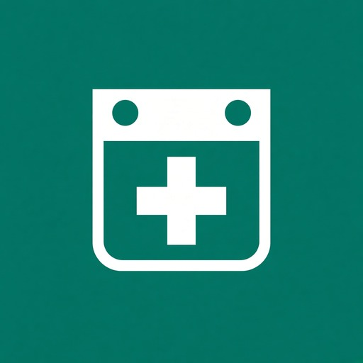
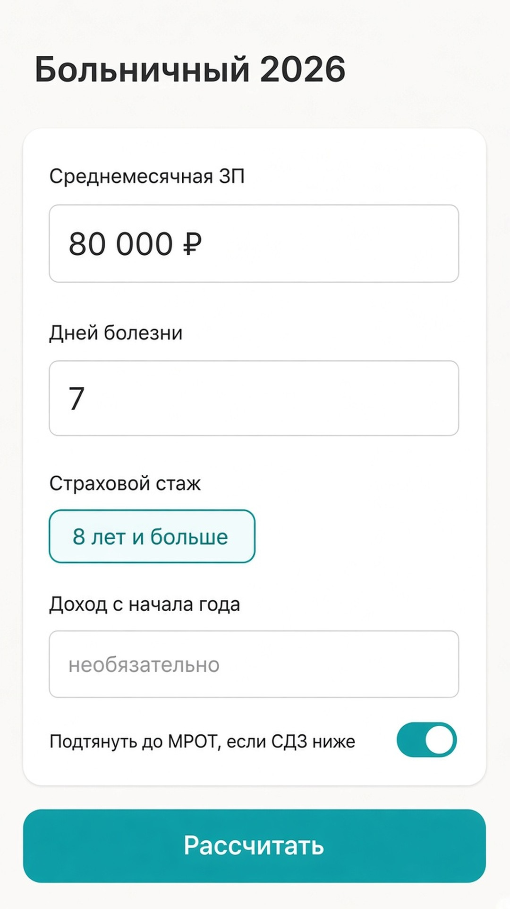
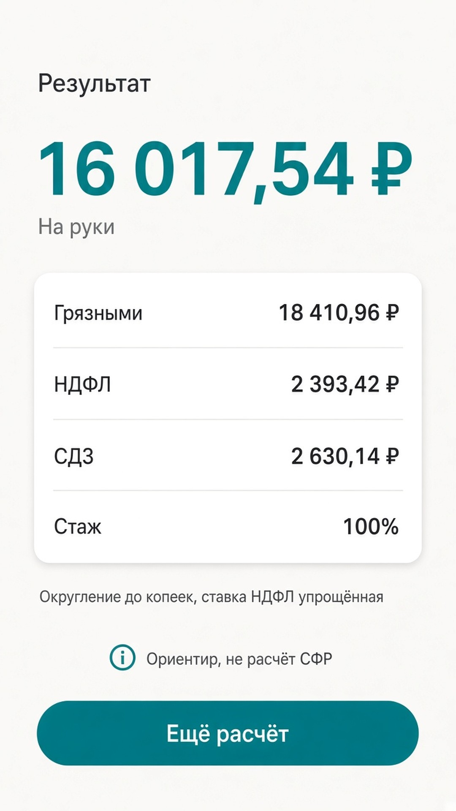
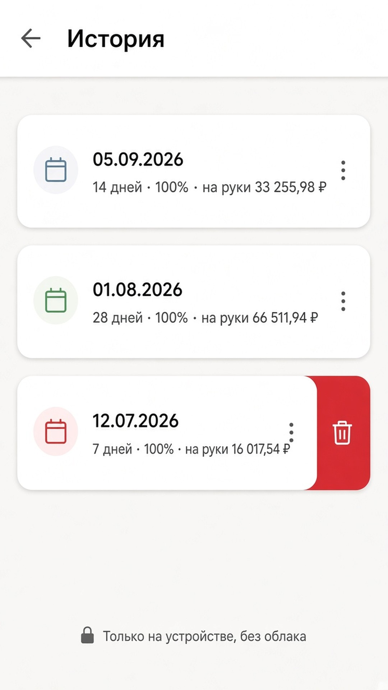
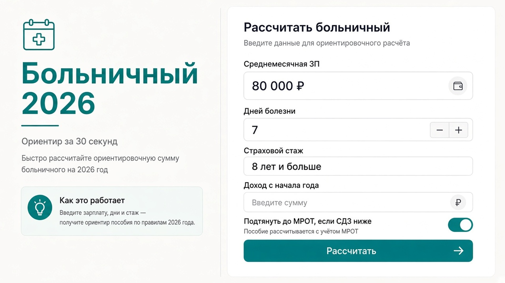
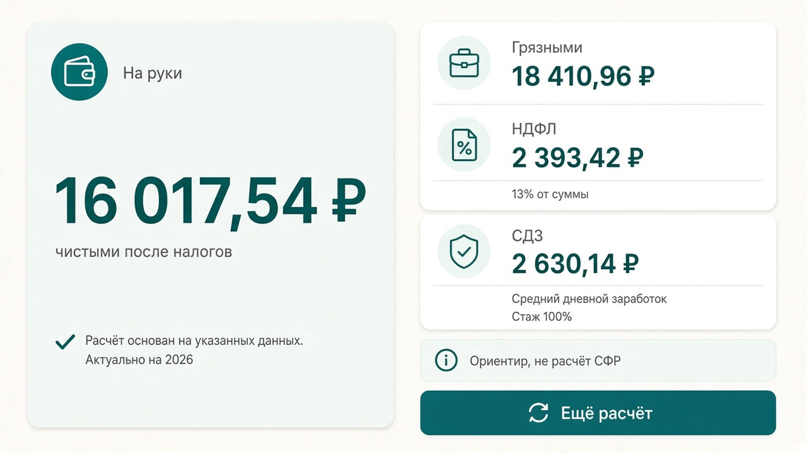
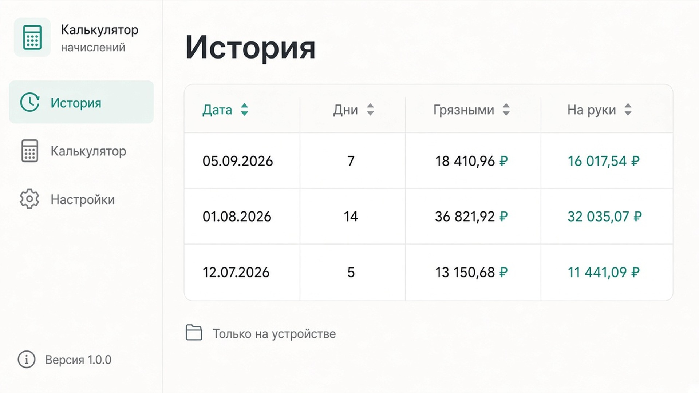

# Больничный 2026

Ориентировочный расчёт пособия по временной нетрудоспособности за ~30 секунд: грязными, НДФЛ и на руки.

Без аккаунта, без облака, без 1С. Android-приложение для RuStore.

[Политика конфиденциальности](rustore/privacy_policy.md) · [Карточка RuStore](rustore/listing.md) · [RuStore](https://www.rustore.ru/catalog/app/ru.svp.sickleave2026)

  

## Скриншоты

### Телефон

| Форма | Результат | История |
| :---: | :---: | :---: |
|  |  |  |

### Планшет

| Форма | Результат | История |
| :---: | :---: | :---: |
|  |  |  |

## Что считает

- сумму **грязными** и **на руки**;
- **НДФЛ** 13% / 15% (с учётом дохода с начала года);
- **СДЗ** за 2 года (÷730);
- процент оплаты по **страховому стажу**: 60% / 80% / 100%;
- пол **МРОТ**, если СДЗ ниже расчёта от МРОТ 2026;
- потолок **предельных баз** страховых взносов 2024–2025.

История последних 20 расчётов хранится только на устройстве.

## Это ориентир

Цифры приблизительные. Не юридическая консультация и не замена бухгалтера или СФР.

В v1 не учитываем: уход за ребёнком, производственную травму, декрет, карантин, районный коэффициент, ЭЛН.
